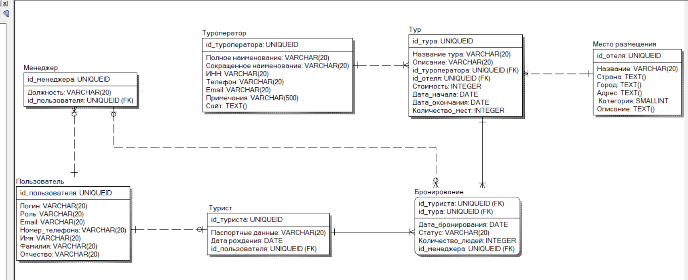

# TravelAgency — турагентство «Весь мир»

Веб-API на ASP.NET Core для просмотра и бронирования туров. Туристы бронируют туры, менеджеры ведут справочники и обрабатывают брони, администратор управляет менеджерами.

## Модель данных



---

# ЛР1. Требования к приложению

## 1. Безопасность паролей

**Пароль не хранится в открытом виде, в БД лежит только хэш.** Хэш-функция необратима: для одних и тех же данных результат один и тот же. При регистрации пароль хэшируется и сохраняется в `PasswordHash`. При входе введённый пароль хэшируется тем же алгоритмом и сравнивается с хэшем в БД.

## 2. Роли

| Роль | Кто это | Что может |
| --- | --- | --- |
| Гость | Неавторизованный посетитель | Смотреть каталог и карточки туров, регистрироваться, входить |
| Tourist | Клиент агентства | Искать туры, бронировать, управлять своими бронями и профилем |
| Manager | Сотрудник агентства | Вести справочники и туры, обрабатывать брони |
| Admin | Владелец системы | Всё, что менеджер, плюс создание и блокировка менеджеров |

Самостоятельно регистрируется только Tourist. Менеджеров и админов заводит администратор, первого админа создаёт приложение при инициализации БД. Менеджер и админ тоже могут бронировать туры для себя: для этого им создаётся профиль туриста (паспортные данные, дата рождения).

## 3. Нетехнические требования

**Гость:**

1. Открыть приложение в браузере.
2. Посмотреть каталог туров и карточку тура.
3. Зарегистрироваться или войти. При попытке забронировать тур переходит на вход.

**Турист:**

1. Зарегистрироваться (логин, пароль, email, телефон, ФИО, паспортные данные, дата рождения) и войти в личный кабинет.
2. Искать и фильтровать туры: страна, город, цена, даты, звёздность отеля, туроператор.
3. Открыть карточку тура: описание, даты, цена, свободные места, отель, туроператор.
4. Забронировать тур, указав количество человек.
5. Посмотреть свои брони со статусами (в обработке, оплачено, отменено).
6. Отменить бронь в статусе «в обработке» и забронировать тот же тур заново.
7. Изменить профиль и пароль, выйти из системы.

**Менеджер:**

1. Войти под учётной записью менеджера.
2. Добавлять, изменять и удалять туроператоров, места размещения и туры.
3. Просматривать все брони, фильтровать по статусу, туру, туристу.
4. Подтверждать оплату и отменять брони.
5. Просматривать список туристов.
6. Бронировать туры для себя, как турист.

**Администратор:** всё, что менеджер, а также создание, изменение и блокировка учётных записей менеджеров.

## 4. Технические требования

### 4.1. Сущности

| Сущность | Атрибуты |
| --- | --- |
| `User` | `Id` (PK), `Login` (уникальный), `PasswordHash`, `Role` (Tourist / Manager / Admin), `Email` (уникальный), `PhoneNumber`, `Name`, `Surname`, `Patronymic` (nullable) |
| `Tourist` | `Id` (PK), `PassportData`, `Birthdate`, `UserId` (FK, уникальный) |
| `Manager` | `Id` (PK), `Position`, `UserId` (FK, уникальный) |
| `TourOperator` | `Id` (PK), `FullName`, `AbbreviatedName`, `Tin` (ИНН, 10 или 12 цифр), `PhoneNumber`, `Email`, `Notes`, `Website` |
| `Location` | `Id` (PK), `Name`, `Country`, `City`, `Address`, `Category` (enum, звёзды 1–5), `Description` |
| `Tour` | `Id` (PK), `Name`, `Description`, `TourOperatorId` (FK), `LocationId` (FK), `Price` (за человека), `StartDate`, `EndDate`, `AvailableSeats` |
| `Booking` | PK (`TouristId`, `TourId`), `BookingDate`, `Status`, `NumberOfPeople`, `ManagerId` (FK, nullable) |

### 4.2. Связи

| Связь | Кратность |
| --- | --- |
| User — Tourist | 1 : 0..1 |
| User — Manager | 1 : 0..1 |
| TourOperator — Tour | 1 : M |
| Location — Tour | 1 : M |
| Tourist — Booking | 1 : M |
| Tour — Booking | 1 : M |
| Manager — Booking | 0..1 : M |

Tourist и Tour связаны как M : N через Booking, поэтому ключ Booking составной.

### 4.3. Статусы бронирования

`Pending` (создана) → `Paid` (менеджер подтвердил оплату) или `Cancelled`. Из `Paid` в `Cancelled` переводит только менеджер. Из `Cancelled` турист может вернуть бронь в `Pending`: при повторной брони той же пары (турист, тур) запись не создаётся заново, а обновляется (статус, количество людей, дата, `ManagerId = NULL`).

## 5. Бизнес-правила

1. Бронь невозможна, если `AvailableSeats` меньше `NumberOfPeople` или тур уже начался.
2. При создании или возобновлении брони места уменьшаются на `NumberOfPeople`, при отмене возвращаются. Всё в одной транзакции.
3. Турист сам отменяет только бронь в статусе `Pending`.
4. Турист видит и меняет только свои данные и свои брони.
5. Логин и email уникальны, пароль не короче 8 символов.
6. `Price` > 0, `EndDate` не раньше `StartDate`, дата рождения не в будущем.
7. Нельзя удалить туроператора или отель, на которых ссылаются туры, и тур с неотменёнными бронями.
8. Доступ к действиям проверяется по роли на сервере, а не только скрытием кнопок.

## 6. PoC и MVP

**PoC** (минимальный набор, доказывающий, что идея работает):

- БД развёрнута (EF Core, Code First, миграции, начальные данные).
- Регистрация и вход с хэшированием паролей, роли Tourist и Manager.
- CRUD туроператоров, мест размещения и туров для менеджера.
- Турист видит список туров и нажимает «Забронировать», создаётся запись в `Booking`.

**MVP** (PoC плюс то, что можно отдать реальным пользователям):

- Поиск и фильтрация туров, карточка тура.
- Личный кабинет туриста: профиль, список броней, отмена, повторная бронь.
- Панель менеджера: список броней, подтверждение оплаты, отмена.
- Все бизнес-правила из раздела 5, понятные сообщения об ошибках.
- Роль Admin и управление менеджерами.

После MVP: обращения в поддержку, отзывы, онлайн-оплата, уведомления по email.


# ЛР2. Code First: инициализация базы данных

## Что реализовано

В базе данных реализованы **5 из 7 сущностей**: `User`, `Tourist`, `Location`, `Tour`, `Booking`. Остальные (`Manager`, `TourOperator`) и связанные с ними поля (`Tour.TourOperatorId`, `Booking.ManagerId`) будут добавлены следующими миграциями. Хэш пароля (`PasswordHash`) тоже добавится позже, вместе с аутентификацией.

- Сущности описаны классами `*Entity` в проекте `TravelAgency.Domain`. Идентификатор (`Id`, `ExternalId`, время создания и изменения) наследуется от базового класса `BaseEntity`.
- Настройки каждой сущности вынесены в отдельный класс в папке `Configurations/` проекта `TravelAgency.Infrastructure`, `TravelAgencyDbContext` их подключает.
- Связь «многие ко многим» между туристом и туром раскрыта сущностью `Booking` с составным первичным ключом (`TouristId`, `TourId`).
- Роль пользователя, статус бронирования и категория отеля — `enum`.
- Миграция создаётся средствами EF Core и применяется командой `dotnet ef database update`.

## Структура решения

Решение состоит из трёх проектов, внутри каждого — свои папки:

```
TravelAgency.sln
├── TravelAgency.Domain                  сущности
│   ├── Entities/
│   │   ├── Base/                        IBaseEntity, BaseEntity
│   │   └── ...Entity.cs                 User, Tourist, Location, Tour, Booking
│   └── Enums/                           UserRoleEnum, BookingStatusEnum, HotelCategoryEnum
├── TravelAgency.Infrastructure          работа с БД
│   ├── Data/
│   │   ├── Configurations/              настройки сущностей
│   │   └── TravelAgencyDbContext.cs
│   └── Migrations/                      миграции EF Core
└── TravelAgency.Web                     Web API
    ├── Configuration/                   подключение БД
    ├── Properties/
    ├── appsettings.json
    ├── appsettings.Development.json
    └── Program.cs
```

Зависимости проектов: `Web` → `Infrastructure` → `Domain`.

